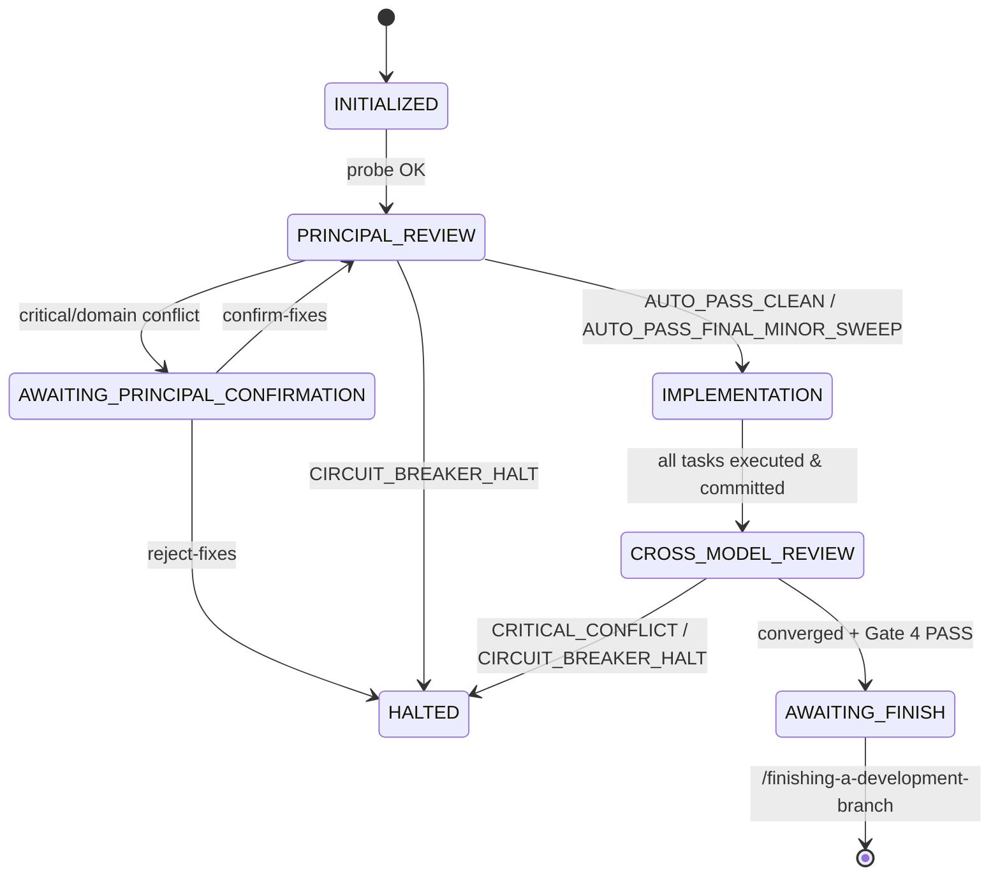

# Autonomous Mode Reference Guide

## 1. Overview & Four-Persona Governance

Autonomous Mode executes software development epics from inception to completion without unnecessary interactive pauses. `lifecycle_runner.py` is the Role 2.2 Orchestrator and coordinates the other personas through the bindings in `/d3nexus:dev-config` (see [orchestration-roles.md](orchestration-roles.md)):

1. **Human Architect (Role 1.0)**: Owns system strategy, gate milestone sign-offs, and critical conflict resolutions. Halted only when high-risk or domain requirement conflicts occur, when a `fix-planner` returns `ESCALATE`, when a model or quota stop occurs, or when final merge approval is needed.
2. **AI Architect & Reviewer (Role 2.1, `ai_architect_reviewer`)**: Drafts `fix_plan_round<N>.md` for high-risk findings through a read-only `fix-planner` dispatch and classifies each plan against the five halt criteria (`PLANNED` or `ESCALATE`). It is also the design authority for Stage 2 revisions. The runner no longer rules `APPROVED`/`ADJUSTED` on plans.
3. **Orchestrator (Role 2.2, `orchestrator`)**: The runner itself. Routes findings by risk, dispatches Role 2.1 and Role 2.3 subagents, enforces the turn budget exactly, writes checkpoints, and halts with `MODEL_UNAVAILABLE` on the first quota, authentication or missing-CLI failure (no fallback, no retry).
4. **Programmer (Role 2.3, `programmer`)**: Executes implementation tasks and applies code fixes (`review-fixer` in `fast-track` or `apply-plan` mode) inside isolated git worktrees. Resolved through `dev_config.py resolve programmer` (default `gemini-4-hydrogen-xhigh`, effort `xhigh`) and dispatched through `dev_config.py dispatch` and the agy profile pool. Never alters architectural boundaries without a `PLANNED` fix plan.

## 2. CLI Flags & Invocation

The Autonomous Lifecycle Runner is invoked via:

```bash
python3 skills/dev-lifecycle/resources/scripts/lifecycle_runner.py --epic <epic_slug> [OPTIONS]
```

### Supported Flags

- `--epic <slug>`: **(Required)** Epic identifier slug matching `.devtool/epic/<epic_slug>/`.
- `--resume`: Resumes execution from the recorded state in `.devtool/state/<epic>.pipeline.json`.
- `--config <path>`: Path to runner configuration JSON file.
- `--reset-stage <stage>`: Resets state machine to a specific stage (`initialized`, `principal_review`, `implementation`, `cross_model_review`, `awaiting_finish`).
- `--confirm-fixes`: Confirms proposed fixes while in `awaiting_principal_confirmation`.
- `--reject-fixes`: Rejects proposed fixes while in `awaiting_principal_confirmation` and halts.
- `--programmer-model <model>`: One-off model override for the Programmer; the default comes from the `programmer` binding in `/d3nexus:dev-config` (kit default `gemini-4-hydrogen-xhigh`).
- `--programmer-effort <effort>`: One-off reasoning effort for the Programmer (`xhigh`, `high`, `medium`, `low`; normalized per CLI; default from the `programmer` binding, `xhigh`).
- `--architect-model <model>` (alias `--assistant-model`): One-off model override for the AI Architect & Reviewer.
- `--root <path>`: Workspace root path (defaults to current working directory).
- `--dry-run`: Simulates execution without spawning child subprocesses.

## 3. State Machine Stages



1. **`INITIALIZED`**: Model capabilities probed via headless CLI before state initialization.
2. **`PRINCIPAL_REVIEW`**: Stage 2 Principal Review automation with multi-round scope narrowing (max 3 rounds).
3. **`AWAITING_PRINCIPAL_CONFIRMATION`**: Human checkpoint halted strictly when critical risks, business requirement conflicts, or shared contract conflicts occur.
4. **`IMPLEMENTATION`**: Stage 3 topological task execution with process group isolation and per-task commits.
5. **`CROSS_MODEL_REVIEW`**: Stage 3 external multi-model review convergence loop; high-risk findings go to a Role 2.1 `fix-planner`.
6. **`AWAITING_FINISH`**: Candidate certified; final executive report displayed; developer prompted for `/finishing-a-development-branch`.
7. **`HALTED`**: Execution stopped due to circuit breaker trip, `FIX_PLAN_ESCALATE`, `MODEL_UNAVAILABLE` (a `model_unavailable` checkpoint precedes the halt), a quota stop, process error, or rejected fix proposal.

## 4. Auto-Triage Gate & Circuit Breakers

| Action / Verdict | Trigger Condition | Autonomous Action |
|---|---|---|
| `AUTO_PASS_CLEAN` | 0 findings in review round | Packages epic (Stage 2) or advances immediately to next stage without pause. |
| `AUTO_PASS_FINAL_MINOR_SWEEP` | 0 Critical, 0 Important, only Minor findings | Applies Minor sweep, commits, packages epic (Stage 2), and advances to next stage without extra review round. |
| `AUTO_FIX_ELIGIBLE` | Critical/Important findings, no contract conflict | Low risk: a Role 2.3 `review-fixer` runs `fast-track`. High risk: a Role 2.1 `fix-planner` writes the plan; `PLANNED` is applied by a `review-fixer` in `apply-plan` mode, `ESCALATE` halts. Commits code/docs and decisions, and enters next round (no mid-loop Stage 2 packaging). |
| `AUTO_PASS_FINAL_SWEEP` | Round 3 ends with 0 Critical | Final fix pass anchored to approved design, packages epic (Stage 2), completes stage without 4th round. |
| `CIRCUIT_BREAKER_HALT (SHARED_CONTRACT_CONFLICT)` | Finding conflicts with `shared-contracts/` | Halts immediately. Strictly prohibited from auto-fixing contract conflicts. |
| `CIRCUIT_BREAKER_HALT (FIX_LOOP)` | Re-reported finding on previously fixed file | Halts immediately. Prevents cyclic code edits. |
| `CIRCUIT_BREAKER_HALT (MAX_ROUNDS_CRITICAL_REMAINING)` | Round 3 completes with unresolved Critical | Halts immediately and outputs Top 3 Highest-Risk Findings. |

## 5. Multi-Round Executive Report Synthesis

Upon review convergence and full Gate 4 PASS, the runner renders a synthesized Executive Report:
- Aggregates the Top 3 Highest-Risk Findings from across all review rounds.
- Displays resolution SHA and verification status for each finding.
- Halts cleanly at `AWAITING_FINISH` to prompt the developer for `/finishing-a-development-branch` (merge to base branch or other actions).


## 6. Checkpoints, Turn Budget & Quota Stops

- The runner writes a checkpoint (`resume_context.py --checkpoint <event>`) after every subagent return (`subagent_returned`) and wave merge (`wave_merged`), and on `turn_budget`, `model_unavailable`, `low_quota_stop` and `quota_low`. It enforces `checkpoint_policy.max_orchestrator_turns_before_checkpoint` exactly (halved in low-quota mode).
- Before Stage 3, each wave and each `/cross-model-review` fix round it runs the quota gate (`dev_config.py quota-check`). Insufficient quota writes `quota_low`, records a `quota` pending decision with recovery commands, and stops without starting a new wave.
- `/d3nexus:dev-config low-quota on` makes the runner finish the task or wave in flight, write `low_quota_stop`, print the resume prompt, and stop.
- Resume from the latest checkpoint with `python3 scripts/resume_context.py --epic <epic_slug>`.
