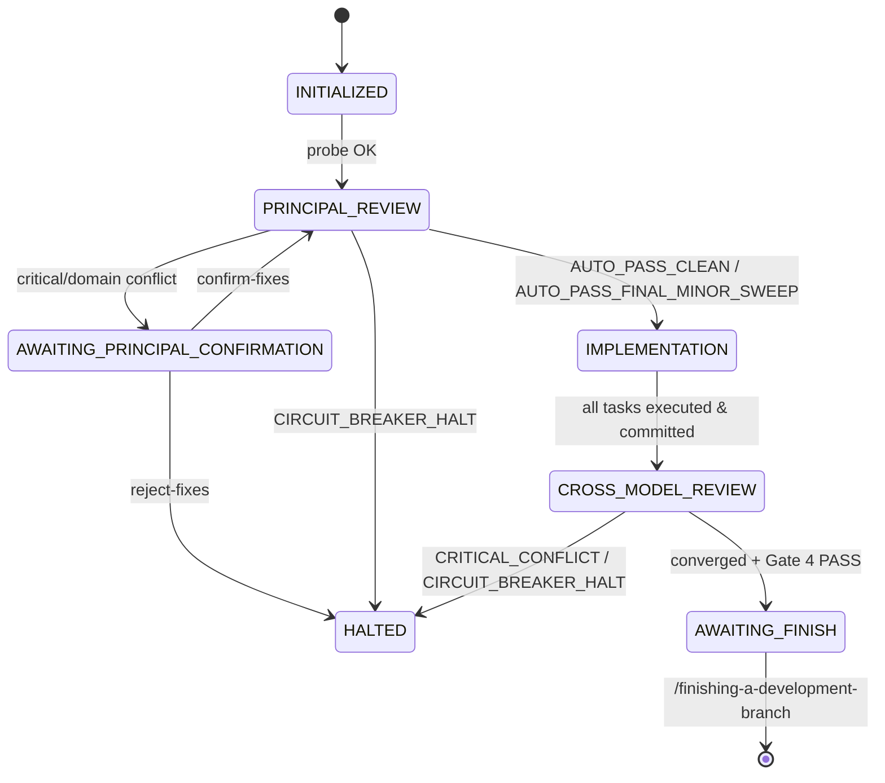

# Autonomous Mode Reference Guide

## 1. Overview & Tri-Role Governance

Autonomous Mode executes software development epics from inception to completion without unnecessary interactive pauses. It coordinates three distinct actors under the Tri-Role Governance Model:

1. **Human Architect (Role 2.1)**: Owns system strategy, gate milestone sign-offs, and critical conflict resolutions. Halted only when high-risk or domain requirement conflicts occur, or when final merge approval is needed.
2. **AI Assistant (Role 2.2)**: Evaluates architectural specifications and fix plans. Inherits the developer's configured model (Argon, Claude, Codex) or `--assistant-model`. Emits deterministic verdicts (`APPROVED`, `ADJUSTED`, `CRITICAL_CONFLICT`).
3. **AI Programmer (Role 2.3)**: Executes implementation tasks and applies code fixes inside isolated git worktrees. Resolves its model from `.devtool/review_config.json["providers"]["programmer"]` (default `gemini-4-hydrogen-xhigh` with `--effort xhigh --mode auto`). Never alters architectural boundaries without approved fix plans.

## 2. CLI Flags & Invocation

The Autonomous Lifecycle Runner is invoked via:

```bash
python3 skills/dev-lifecycle/resources/scripts/lifecycle_runner.py --epic <epic_slug> [OPTIONS]
```

### Supported Flags

- `--epic <slug>`: **(Required)** Epic identifier slug matching `.devtool/epic/<epic_slug>/`.
- `--resume`: Resumes execution from the recorded state in `.devtool/state/<epic>.pipeline.json`.
- `--config <path>`: Path to runner configuration JSON file.
- `--reset-stage <stage>`: Resets state machine to a specific stage (`initialized`, `principal_review`, `implementation`, `cross_model_review`, `awaiting_finish`).
- `--confirm-fixes`: Confirms proposed fixes while in `awaiting_principal_confirmation`.
- `--reject-fixes`: Rejects proposed fixes while in `awaiting_principal_confirmation` and halts.
- `--programmer-model <model>`: Model identifier for AI Programmer (defaults to `.devtool/review_config.json["providers"]["programmer"]` / `gemini-4-hydrogen-xhigh`).
- `--assistant-model <model>`: Model override for AI Assistant.
- `--root <path>`: Workspace root path (defaults to current working directory).
- `--dry-run`: Simulates execution without spawning child subprocesses.

## 3. State Machine Stages



1. **`INITIALIZED`**: Model capabilities probed via headless CLI before state initialization.
2. **`PRINCIPAL_REVIEW`**: Stage 2 Principal Review automation with multi-round scope narrowing (max 3 rounds).
3. **`AWAITING_PRINCIPAL_CONFIRMATION`**: Human checkpoint halted strictly when critical risks, business requirement conflicts, or shared contract conflicts occur.
4. **`IMPLEMENTATION`**: Stage 3 topological task execution with process group isolation and per-task commits.
5. **`CROSS_MODEL_REVIEW`**: Stage 3 external multi-model review convergence loop with fix plan evaluation.
6. **`AWAITING_FINISH`**: Candidate certified; final executive report displayed; developer prompted for `/finishing-a-development-branch`.
7. **`HALTED`**: Execution stopped due to circuit breaker trip, process error, or rejected fix proposal.

## 4. Auto-Triage Gate & Circuit Breakers

| Action / Verdict | Trigger Condition | Autonomous Action |
|---|---|---|
| `AUTO_PASS_CLEAN` | 0 findings in review round | Packages epic (Stage 2) or advances immediately to next stage without pause. |
| `AUTO_PASS_FINAL_MINOR_SWEEP` | 0 Critical, 0 Important, only Minor findings | Applies Minor sweep, commits, packages epic (Stage 2), and advances to next stage without extra review round. |
| `AUTO_FIX_ELIGIBLE` | Critical/Important findings, no contract conflict | Drafts fix plan, evaluates plan, applies fixes, commits code/docs and decisions, and enters next round (no mid-loop Stage 2 packaging). |
| `AUTO_PASS_FINAL_SWEEP` | Round 3 ends with 0 Critical | Final fix pass anchored to approved design, packages epic (Stage 2), completes stage without 4th round. |
| `CIRCUIT_BREAKER_HALT (SHARED_CONTRACT_CONFLICT)` | Finding conflicts with `shared-contracts/` | Halts immediately. Strictly prohibited from auto-fixing contract conflicts. |
| `CIRCUIT_BREAKER_HALT (FIX_LOOP)` | Re-reported finding on previously fixed file | Halts immediately. Prevents cyclic code edits. |
| `CIRCUIT_BREAKER_HALT (MAX_ROUNDS_CRITICAL_REMAINING)` | Round 3 completes with unresolved Critical | Halts immediately and outputs Top 3 Highest-Risk Findings. |

## 5. Multi-Round Executive Report Synthesis

Upon review convergence and full Gate 4 PASS, the runner renders a synthesized Executive Report:
- Aggregates the Top 3 Highest-Risk Findings from across all review rounds.
- Displays resolution SHA and verification status for each finding.
- Halts cleanly at `AWAITING_FINISH` to prompt the developer for `/finishing-a-development-branch` (merge to base branch or other actions).

