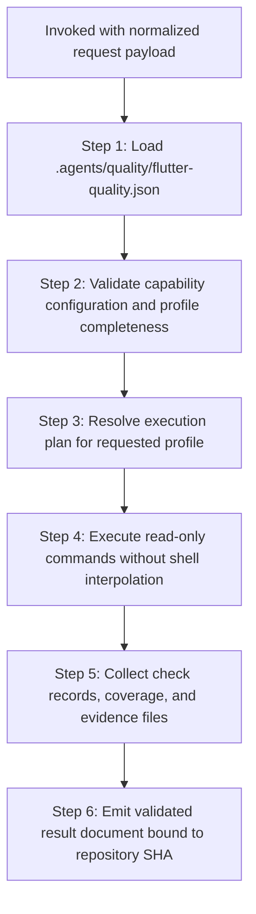

# Flutter Quality Assurance Provider

## Overview

You are the Flutter Quality Provider (`d3nexus:flutter-quality-check`). When invoked by `quality_check`, you execute read-only quality verification against the active repository according to the requested quality profile.

You do not guess commands from file layouts. You load capabilities from `.agents/quality/flutter-quality.json`, execute the project-declared command arrays, collect evidence, and output a validated result document adhering to the shared [Provider Result Contract](../quality_check/references/provider-result-contract.md).

## Workflow



### Step 1: Configuration Loading and Validation

Load the project capability manifest `.agents/quality/flutter-quality.json` from the repository root:

```bash
python3 skills/flutter-quality-check/resources/scripts/validate_flutter_quality.py .agents/quality/flutter-quality.json --profile "<profile>"
```

- If `.agents/quality/flutter-quality.json` is missing or invalid: emit status `BLOCKED`.
- If the requested profile is not configured: emit status `BLOCKED`.
- For profile `epic`: if `boundaries`, `test`, or `coverage` capabilities are missing: emit status `BLOCKED`.

### Step 2: Read-Only Command Execution

Execute commands declared in `capabilities` for the target profile:
1. Commands are executed as structured argument arrays (no shell interpolation).
   - An argument beginning with `{skills_dir}` is resolved to the directory containing this plugin's `skills/` folders (the parent of `flutter-quality-check/`), so manifests can call sibling skill scripts without machine-specific paths (e.g. `["python3", "{skills_dir}/sync-shared-contracts/resources/scripts/sync_contracts.py", "diff-check", "--base-ref", "{base_ref}"]`).
   - An argument containing `{base_ref}` is substituted with the normalized `base_ref` invocation parameter from `quality_check` (falling back to `develop` or the repository default only when `base_ref` was not supplied).
2. All commands run from the resolved repository root.
3. If an executable is missing or cannot be spawned: record check status as `BLOCKED`.
4. If a command runs and reports defects (nonzero exit code):
   - For governance and contract capabilities (`contracts`, `contracts_<domain>`, and `contract_diff`): exit code `0` records `PASS`, exit code `2` (or JSON `"status": "BLOCKED"`) records `BLOCKED`, and any other nonzero exit code (such as `1`) records `FAIL`.
   - For all other capabilities: nonzero exit code records `FAIL`.
5. If a command succeeds (zero exit code): record check status as `PASS`.

Standard capabilities modeled after `bloc_digital_wallet`:
- **Format**: `./scripts/dartfmt.sh` (or `fvm dart format -l 99`)
- **Analyze**: `fvm flutter analyze` with strict `analysis_options.yaml`
- **Boundaries**: `./scripts/check_module_boundaries.sh` (with `scripts/module_boundary_whitelist.txt`)
- **License**: `./scripts/check_license_header.sh` (`addlicense` with `header_template.txt`)
- **Unit & Feature Tests**: `melos run test`
- **Coverage**: `./scripts/testWithCoverage.sh` (parses `coverage_report/lcov.info`)

### Step 3: Semantic Audits

Execute specialist audits as configured:
- **Architecture Gate**: Evaluates Clean Architecture feature-layer isolation, BLoC immutability, and boundary whitelisting.
- **Coverage Gate**: Parses `coverage_report/lcov.info` and evaluates against configured threshold.
- **Specialist Audits**: Dispatches `@security-audit`, `@architecture-audit`, `@flutter-ui-audit`, and `@code-health-audit`.
  - **Scope-Aware UI Audit (`scope_unmodified`)**: Before dispatching `@flutter-ui-audit`, inspect `git diff --name-only <base_ref>...HEAD`. If zero UI/presentation `.dart` files (`**/presentation/**`, `**/ui/**`, `**/widgets/**`, `**/screens/**`, `**/pages/**`, `**/views/**`) were modified, skip `@flutter-ui-audit` and record the check as `status: "NOT_APPLICABLE"` with `not_applicable_reason: {"code": "scope_unmodified", "detail": "No Flutter UI/presentation files modified against base_ref"}`.

### Step 4: Result Assembly and Contract Emission

Assemble the result document matching [provider-result.schema.json](../quality_check/resources/schemas/provider-result.schema.json):

- `provider_id`: `"flutter-core"` (or matching invocation identifier)
- `contract_version`: `1`
- `profile`: `<profile>`
- `repository_sha`: Verified commit SHA matching invocation
- `status`: Aggregated provider status (`FAIL` if any check failed, `BLOCKED` if any check blocked, else `PASS`)
- `started_head` and `finished_head`: Git SHA recorded before and after execution
- `checks`, `coverage`, `evidence`, `blockers`, `warnings`

Return the result document to the orchestrator.

## References & Resources

- [Capability Schema](resources/schemas/flutter-quality.schema.json): Machine-readable JSON Schema for Flutter capability manifests.
- [Capability Validator](resources/scripts/validate_flutter_quality.py): Script and CLI validator for Flutter capability files.
- [Valid Fixture](resources/fixtures/valid_flutter_quality.json): Reference valid capability configuration fixture modeled on `bloc_digital_wallet`.
