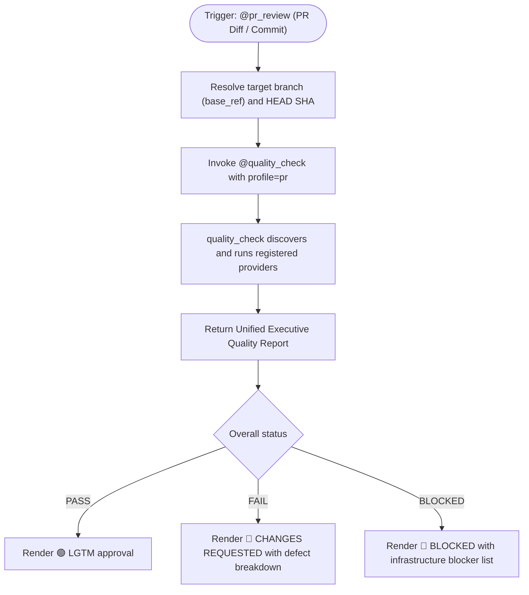

# Pull Request Review Skill

## Overview

The PR Review skill automates Pull Request code review by delegating quality verification to the platform-neutral
orchestrator [`@quality_check`](../quality_check/SKILL.md).

It requests the `pr` quality profile, ensuring fast, focused verification of changed scope, required architecture gates,
linting, unit tests, and security audits as registered by the project in `.agents/quality/check_quality.json`.

## Architecture and Delegation Flow



## Input Methods

| Input Type | Description | Command / Usage |
| :--- | :--- | :--- |
| **Working Diff** | Review staged or uncommitted local changes | `@pr_review` (analyzes current `git diff`) |
| **Commit ID** | Review changes introduced by a specific commit | `git show <COMMIT_ID>` or `@pr_review commit=<COMMIT_ID>` |
| **PR Number / Diff** | Review Pull Request changes via GitHub CLI | `gh pr diff <PR_NUMBER>` |
| **Branch Range** | Review changes against the base branch | `git diff origin/main...HEAD` or `git diff origin/develop...HEAD` |

## Review Workflow

1. **Resolve Identity & Base**:
   - Resolve target branch base reference (e.g. `main`, `develop`) and candidate git commit SHA.
2. **Invoke Quality Orchestration via `@quality_check`**:
   - Construct normalized invocation request:
     ```json
     {
       "contract_version": 1,
       "profile": "pr",
       "base_ref": "<base_ref>",
       "repository_sha": "<head_sha>"
     }
     ```
   - Delegate execution to `@quality_check`, which loads `.agents/quality/check_quality.json`, fans out to registered providers supporting `pr`, and validates results.
3. **Synthesize & Render Verdict**:
   - Consume the unified executive report from `@quality_check`.
   - **🟢 LGTM**: Granted only when overall status is `PASS`.
   - **🔴 CHANGES REQUESTED**: If status is `FAIL`, detail all failing checks, code smells, and defect locations.
   - **🔴 BLOCKED**: If status is `BLOCKED`, report missing dependencies, unexecutable tools, or unresolvable contracts.

## Executive Report Format

PR reviews format output using the standard [Executive Report Format](../quality_check/references/executive-report-format.md) emitted by `@quality_check`.
