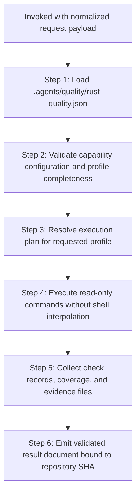

# Rust Quality Assurance Provider

## Overview

You are the Rust Quality Provider (`d3nexus:rust-quality-check`). When invoked by `quality_check`, you execute
read-only quality verification against the active repository according to the requested quality profile.

You do not guess commands from file layouts. You load capabilities from `.agents/quality/rust-quality.json`, execute
the project-declared command arrays, collect evidence, and output a validated result document adhering to the shared
[Provider Result Contract](../quality_check/references/provider-result-contract.md).

## Workflow



### Step 1: Configuration Loading and Validation

Load the project capability manifest `.agents/quality/rust-quality.json` from the repository root:

```bash
python3 skills/rust-quality-check/resources/scripts/validate_rust_quality.py .agents/quality/rust-quality.json --profile "<profile>"
```

- If `.agents/quality/rust-quality.json` is missing or invalid: emit status `BLOCKED`.
- If the requested profile is not configured: emit status `BLOCKED`.
- For profile `epic`: if the `architecture` capability is missing: emit status `BLOCKED`.

### Step 2: Read-Only Command Execution

Execute commands declared in `capabilities` for the target profile:
1. Commands are executed as structured argument arrays (no shell interpolation).
   An argument beginning with `{skills_dir}` is resolved to the directory containing this plugin's `skills/` folders (the parent of `rust-quality-check/`), so manifests can call sibling skill scripts without machine-specific paths.
2. All commands run from the resolved repository root.
3. If an executable is missing or cannot be spawned: record check status as `BLOCKED`.
4. If a command runs and reports defects (nonzero exit code): record check status as `FAIL`.
5. If a command succeeds (zero exit code): record check status as `PASS`.

Independent commands (e.g. `format`, `check`, `clippy`, `test`) may run concurrently.

### Step 3: Semantic Audits

Execute specialist audits as configured:
- **Architecture Gate**: Authoritative `cargo run -p xtask -- check-architecture` evaluates crate boundaries, Clean Architecture layer inversion, and MVI state immutability.
- **Coverage Gate**: Evaluates `cargo-llvm-cov` or project coverage wrapper against configured threshold.
- **Security & Dependency Policy**: Evaluates `cargo-deny` and `cargo-audit` for scheduled and release profiles.

### Step 4: Result Assembly and Contract Emission

Assemble the result document matching [provider-result.schema.json](../quality_check/resources/schemas/provider-result.schema.json):

- `provider_id`: `"rust-core"` (or matching invocation identifier)
- `contract_version`: `1`
- `profile`: `<profile>`
- `repository_sha`: Verified commit SHA matching invocation
- `status`: Aggregated provider status (`FAIL` if any check failed, `BLOCKED` if any check blocked, else `PASS`)
- `started_head` and `finished_head`: Git SHA recorded before and after execution
- `checks`, `coverage`, `evidence`, `blockers`, `warnings`

Return the result document to the orchestrator.

## References & Resources

- [Rust Capability Contract](references/rust-capability-contract.md): Format and rules for `.agents/quality/rust-quality.json`.
- [Rust Architecture Governance](references/rust-architecture-governance.md): Konsist-equivalent architecture policies via Cargo metadata and `xtask`.
- [Rust Tool Mapping](references/rust-tool-mapping.md): Mapping Android/Flutter quality concepts to Rust ecosystem equivalents.
- [Capability Schema](resources/schemas/rust-quality.schema.json): Machine-readable JSON Schema for Rust capability manifests.
- [Capability Validator](resources/scripts/validate_rust_quality.py): Script and CLI validator for Rust capability files.
- [Valid Fixture](resources/fixtures/valid_rust_quality.json): Reference valid capability configuration fixture.
