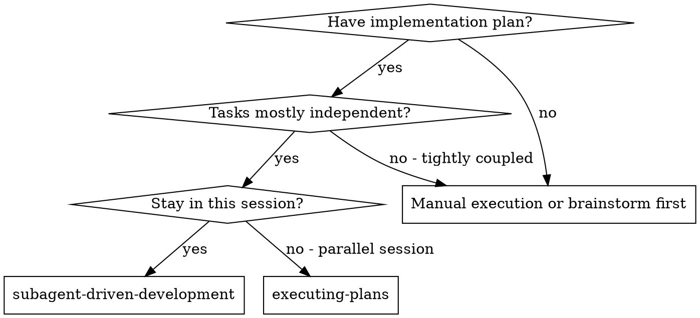
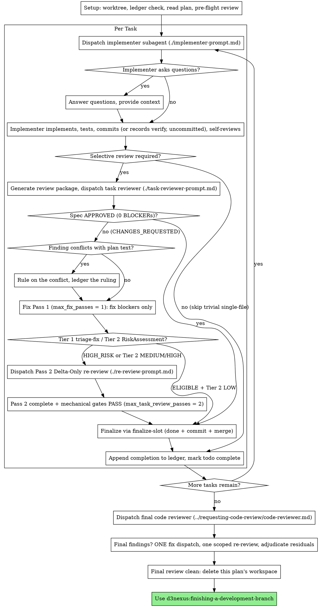

# Subagent-Driven Development

Execute plan by dispatching a fresh implementer subagent per task, a task review (spec compliance + code quality) after each, and a broad whole-branch review at the end.

**Why subagents:** You delegate tasks to specialized agents with isolated context. By precisely crafting their instructions and context, you ensure they stay focused and succeed at their task. They should never inherit your session's context or history — you construct exactly what they need. This also preserves your own context for coordination work.

**Core principle:** Fresh subagent per task + task review (spec + quality) + broad final review = high quality, fast iteration

**Narration:** between tool calls, narrate at most one short line — the
ledger and the tool results carry the record.

**Continuous execution:** Do not pause to check in with your human partner between tasks. Execute all tasks from the plan without stopping. The only reasons to stop are the four named below, or all tasks complete. "Should I continue?" prompts and progress summaries waste their time — they asked you to execute the plan, so execute it.

**Rulings, not stalls.** A running plan does not wait on a human. Conflicts,
ambiguities, plan defects, a cap you would have asked to exceed — decide
them. The spec is the binding authority, the plan is its argument, and your
judgment settles what neither answers. Record every decision in the ledger as
`Ruling: <what you decided> — <why> — <what it costs if wrong>`, and keep
going. A wrong ruling costs rework your human partner can see and undo; a
session parked on a question costs their whole day and buys nothing.

Four things stop you, and only these: an irreversible or destructive
operation; a security-sensitive action; a side effect outside this worktree
that norms say you ask about first (a merge, a push to a shared branch, a
publish); and a plan so broken that every path forward is a guess. For those,
stop and ask.

## When to Use



**vs. Executing Plans (parallel session):**
- Same session (no context switch)
- Fresh subagent per task (no context pollution)
- Review after each task (spec compliance + code quality), broad review at the end
- Faster iteration (no human-in-loop between tasks)

## The Process



## Setup

Ensure the work happens in an isolated workspace: use
d3nexus:using-git-worktrees to create one or verify the existing one.
Never start implementation on a main/master branch without your human
partner's explicit consent.

Conversation memory does not survive compaction. In real sessions,
controllers that lost their place have re-dispatched entire completed task
sequences — the single most expensive failure observed. Track progress in
a ledger file, not only in todos.

- Each plan owns a workspace: at skill start, run this skill's
  `scripts/sdd-workspace PLAN_FILE` — it prints the plan's git-ignored
  directory (`<repo-root>/.superpowers/sdd/<plan-basename>/`), home to
  every artifact for THIS plan: ledger, briefs, reports, review packages.
  Another plan's directory is never yours to read or write.
- Check for this plan's ledger at `<workspace>/progress.md`. If its first
  line names your plan file, tasks with a `Task <N>: complete` line are DONE
  — do not re-dispatch them; resume at the first task without one. A task
  whose last line is a fix round is mid-loop: resume the loop at the next
  round. A ledger whose first line names a different plan file — or a stray
  ledger at the old flat path `.superpowers/sdd/progress.md` — is another
  plan's progress: leave it in place and start your own, fresh.
- Create the ledger with its identity as the first line:
  `# SDD ledger — plan: <plan file path>`.
- The ledger is your recovery map: the commits it names exist in git even
  when your context no longer remembers creating them. After compaction,
  trust the ledger and `git log` over your own recollection.
- `git clean -fdx` will destroy the workspace (it's git-ignored scratch); if
  that happens, recover from `git log`.

Read the plan once, note its context and Global Constraints, and create a
todo per task. If the plan names a Spec, read that too: the spec is the
authority the plan argues from, and conflicts inside the plan resolve
against it. A plan with no reachable spec gets a ledger note saying so —
rulings made without one are provisional.

Before dispatching Task 1, scan the plan once for conflicts, writing down
what you checked as you check it:

- tasks that contradict each other or the plan's Global Constraints
- anything the plan explicitly mandates that the review rubric treats as a
  defect (a test that asserts nothing, verbatim duplication of a logic block)

The scan's output is a table, not a verdict. One row for every pair of tasks
that share a file or an interface: the two tasks, what one produces against
what the other consumes, and what you found. One row for every task: whether
its own text agrees with itself — the tests it specifies against the code it
specifies, the files it creates against the files it later touches. "The scan
is clean" without those rows is not a scan you ran.

Write the table to the ledger. Rule on everything you find before execution
begins — each finding against the plan text that mandates it — and record
each ruling in the ledger. If the scan is clean, proceed without comment.
Rule on each conflict it surfaces — the spec is the binding authority, the
plan is its argument — record the ruling beside its row, and dispatch
Task 1. The review loop remains the net for conflicts that only emerge from
implementation.

## Model Selection

**Inside an epic (`d3nexus:dev-implementation`), models are bound to personas, not chosen per task.** Resolve each subagent's binding with `python3 scripts/dev_config.py resolve <persona> --format argv --mode <read-only|write>`: Role 2.3 Programmer (`programmer`, `--mode write`) for `task-implementer`, `review-fixer` and `gate4-verifier`; Role 2.1 AI Architect & Reviewer (`ai_architect_reviewer`, `--mode read-only`) for `task-reviewer` and `fix-planner`. Dispatch Role 2.3 through `dev_config.py dispatch` (agy profile pool, lease file `agy_profile_leases.json`). Never substitute a lighter model, and never fall back or retry on a missing CLI, failed auth or exhausted quota: checkpoint `model_unavailable`, record a blocker with the fallback command, stop. The tiers below apply only to standalone use outside an epic.

Use the least powerful model that can handle each role to conserve cost and increase speed.

**Mechanical implementation tasks** (isolated functions, clear specs, 1-2 files): use a fast, cheap model. Most implementation tasks are mechanical when the plan is well-specified.

**Integration and judgment tasks** (multi-file coordination, pattern matching, debugging): use a standard model.

**Architecture and design tasks**: use the most capable available model.
The final whole-branch review is one of these — dispatch it on the most
capable available model, not the session default.

**Review tasks**: choose the model with the same judgment, scaled to the
diff's size, complexity, and risk. A small mechanical diff does not need the
most capable model; a subtle concurrency change does. Scoped re-reviews of
small fix diffs take a cheap-to-mid tier.

**Fix-loop escalation (rounds 4-5)**: use a model at least one tier above
the implementer that got stuck.

**Always specify the model explicitly when dispatching a subagent.** An
omitted model inherits your session's model — often the most capable and
most expensive — which silently defeats this section.

**Turn count beats token price.** Wall-clock and context cost scale with how
many turns a subagent takes, and the cheapest models routinely take 2-3× the
turns on multi-step work — costing more overall. Use a mid-tier model as the
floor for reviewers and for implementers working from prose descriptions.
When the task's plan text contains the complete code to write, the
implementation is transcription plus testing: use the cheapest tier for
that implementer. Single-file mechanical fixes also take the cheapest tier.

**Task complexity signals (implementation tasks):**
- Touches 1-2 files with a complete spec → cheap model
- Touches multiple files with integration concerns → standard model
- Requires design judgment or broad codebase understanding → most capable model

## The Task Loop

**Batch small same-shape work.** When the plan lists several tasks that are
each a small, independent edit of the same kind — the same one-line fix,
constant change, or field addition repeated across files — do not dispatch
one subagent per task. Compose ONE dispatch brief listing every file and
its change, send the whole batch to a single subagent, and review its diff
as one unit. Reserve one-dispatch-per-task for work that needs its own
judgment, its own tests, or its own review surface.

Everything you paste into a dispatch prompt — and everything a subagent
prints back — stays resident in your context for the rest of the session
and is re-read on every later turn. Hand artifacts over as files.

**Waiting on dispatched subagents:** never poll a wait interface with
short timeouts, and never sit in one silent, open-ended wait either.
While you have local work — ledger updates, packaging the next review,
reading reports — keep working; child results arrive on their own.
When you are genuinely idle, wait in bounded stretches (five to ten
minutes, where your platform allows), and between stretches post one
line of status and reconcile your live children: list them, and chase
any that finished without reporting. A bounded stretch keeps nearly
all of a long wait's efficiency while guaranteeing a stuck or lost
child is noticed within minutes, not at the end of the session.

### 1. Dispatch the implementer

Record BASE (`git rev-parse HEAD`) before dispatching — the review package
and fix-round diffs need it.

**Pre-Dispatch Status Gate (tasks with a Verification table):** Transition the
task to `in-progress` BEFORE dispatching the implementer:
- *2-slot pool mode (keeps `main_wt` clean)*: `python3 skills/dev-implementation/resources/scripts/manage_worker_pool.py sync --epic-dir <epic_dir> --epic-slug <epic_slug> --slot <1|2> --task <id> [--wave <k>] --status working`
- *Single-worktree / non-pool mode*: `python3 skills/dev-implementation/resources/scripts/sync_task_status.py task <id> in-progress`

**A task with a Verification table** (an epic task run by
d3nexus:dev-implementation) is never committed by the implementer. It runs
`run_task_checks.py red` before implementing and `run_task_checks.py verify`
after its last change and after every fix round, and leaves the change
uncommitted: the done gate refuses evidence recorded after a commit. You
build every review package from the uncommitted diff (`WORKTREE` in place of
HEAD, below), and you make the task's single commit yourself, after
`sync_task_status.py task <id> done` passes (dev-implementation Phase 2).
A task without a Verification table keeps the commit flow described here.

- **Task brief:** before dispatching an implementer, run this skill's
  `scripts/task-brief PLAN_FILE N` — it extracts the task's full text to a
  uniquely named file and prints the path. Compose the dispatch so the
  brief stays the single source of
  requirements. Your dispatch should contain: (1) one line on where this
  task fits in the project; (2) the brief path, introduced as "read this
  first — it is your requirements, with the exact values to use verbatim";
  (3) interfaces and decisions from earlier tasks that the brief cannot
  know; (4) your resolution of any ambiguity you noticed in the brief;
  (5) the report-file path and report contract. For a task with a
  Verification table, also fill the templates' `[SCRIPTS]` (the absolute
  path of dev-implementation's `resources/scripts` directory) and
  `[TASK_MIRROR]` (the task's file under `.devtool/epic/<epic_dir>/`), in
  the implementer and the task-reviewer dispatch alike. Exact values (numbers,
  magic strings, signatures, test cases) appear only in the brief. Never
  make a subagent read the whole plan file.
- **Report file:** name the implementer's report file after the brief
  (brief `…/task-N-brief.md` → report `…/task-N-report.md`) and put it in
  the dispatch prompt. The implementer writes the full report there and
  returns only status, commits, a one-line test summary, and concerns.
- A dispatch prompt describes one task, not the session's history. Do not
  paste accumulated prior-task summaries ("state after Tasks 1-3") into
  later dispatches — a real session's dispatch hit 42k chars of which 99%
  was pasted history. A fresh subagent needs its task, the interfaces it
  touches, and the global constraints. Nothing else.
- The dispatch carries the no-subagents contract (it is in the
  implementer template): the implementer never dispatches subagents —
  not helpers, and never a reviewer. Review arrives from you, after the
  report. In real sessions, every reviewer a worker spawned duplicated
  the task review the controller dispatched anyway — a full extra
  review seat per task.
- If an earlier task parked a finding in the area this task touches, carry
  a pointer to that ledger entry in the dispatch.
- Record the implementer's agent identity from the dispatch result —
  fix-loop rounds 1-3 resume this agent.
- Never dispatch multiple implementation subagents in parallel (conflicts).

Template: [implementer-prompt.md](implementer-prompt.md)

### 2. Handle the report

Implementer subagents report one of four statuses. Handle each appropriately:

**DONE:** Generate the review package (`scripts/review-package PLAN_FILE BASE HEAD`, from this skill's directory — it prints the unique file path it wrote; BASE is the commit you recorded before dispatching the implementer — never `HEAD~1`, which silently drops all but the last commit of a multi-commit task; for a task with a Verification table, pass `WORKTREE` as HEAD), then dispatch the task reviewer with the printed path.

**DONE_WITH_CONCERNS:** The implementer completed the work but flagged doubts. Read the concerns before proceeding. If the concerns are about correctness or scope, address them before review. If they're observations (e.g., "this file is getting large"), note them and proceed to review.

**NEEDS_CONTEXT:** The implementer needs information that wasn't provided. Provide the missing context and re-dispatch.

**BLOCKED:** The implementer cannot complete the task. Assess the blocker:
1. If it's a context problem, provide more context and re-dispatch with the same model
2. If the task requires more reasoning, re-dispatch with a more capable model
3. If the task is too large, break it into smaller pieces
4. If the plan itself is wrong, rule on the correction, ledger it, and re-dispatch with the ruling carried in the dispatch

**Never** ignore an escalation or force the same model to retry without changes. If the implementer said it's stuck, something needs to change.

If the implementer asks questions — before starting or mid-task — answer
clearly and completely, provide additional context if needed, and don't
rush it into implementation.

### 3. Review the task

Per-task reviews are selective, task-scoped gates. The broad review happens once, at the final whole-branch review.

- **Pre-Review Status Gate (tasks with a Verification table):** Whenever `task-reviewer` IS dispatched, transition task status to `review` BEFORE spawning the reviewer:
  - *2-slot pool mode (preserves uncommitted slot changes and keeps `main_wt` clean)*: `python3 skills/dev-implementation/resources/scripts/manage_worker_pool.py sync --epic-dir <epic_dir> --epic-slug <epic_slug> --slot <1|2> --task <id> [--wave <k>] --status review`
  - *Single-worktree / non-pool mode*: `python3 skills/dev-implementation/resources/scripts/sync_task_status.py task <id> review`
  If review enters Step 4 (fix loop), immediately return status to `in-progress` (`manage_worker_pool.py sync ... --status working --no-reset` in pool mode, or `sync_task_status.py task <id> in-progress` in single-worktree mode), then flip back to `review` (`--status review`) before re-review.

- **Reviewer persona & Blocker-Only rubric:** In an epic, `task-reviewer` is a Role 2.1 AI Architect & Reviewer subagent on the `ai_architect_reviewer` binding (`--mode read-only`). It reads the slot diff, `src/`/`tests/`, the task file and evidence, runs only `run_task_checks.py status` and `check_bdd_traceability.py`, and never edits, commits or runs test suites. Pass 1 (`--review-pass 1`) audits comprehensively (`max_task_review_passes = 2`, `max_fix_passes = 1`): `CHANGES_REQUESTED` requires at least one `BLOCKER` (`BDD_VIOLATION`, `CONTRACT_SCHEMA_VIOLATION`, `RUNTIME_SAFETY`, `OWNERSHIP_ARCHITECTURE_VIOLATION`); minor refinements are logged as `NON_BLOCKING_OBSERVATION` under `Observations (Non-Blocking)` / `"observations"` with verdict `APPROVED`. On `APPROVED`, the Orchestrator finalizes (`finalize-slot --mode pass1-approved`).
- **Selective `task-reviewer` gating:** Dispatch `task-reviewer` **ONLY** when `review_tier: "full"` in task frontmatter, OR task labels include any high-risk trigger (`security`, `architecture`, `concurrency`, `contract`), OR the task modifies `> 2` non-test modules. For trivial single-file or routine tasks without high-risk triggers (where `review_tier` is unset or `skip`), skip `task-reviewer` and rely on implementer self-review, `run_task_checks.py verify`, and the final whole-branch review. Whenever a `task-reviewer` IS dispatched, never accept a report missing spec compliance, task quality, or the structured JSON contract.
- **Rule 3 & Rule 5 discipline:** Require bounded reads (`StartLine`/`EndLine` or `sed -n 'X,Yp'` with symbol search on files `> 200` lines) and enforce the Zero-Fluff Output Cap for subagent narration while preserving Verdicts, Findings tables, gate results, and status contracts.
- Hand the reviewer its diff as a file: run this skill's
  `scripts/review-package PLAN_FILE BASE HEAD` and pass the reviewer the file path
  it prints (or, without bash: `git log --oneline`, `git diff --stat`,
  and `git diff -U5` for the range, redirected to one uniquely named
  file). For a task with a Verification table the change is uncommitted:
  run `scripts/review-package PLAN_FILE BASE WORKTREE`, which packages the
  working tree against BASE through a temporary index (the real index is
  never touched) and prints the tree id it packaged — keep that id for the
  fix loop. The output never enters your own context, and the reviewer sees
  the commit list, stat summary, and full diff with context in one Read
  call. Use the BASE you recorded before dispatching the implementer —
  never `HEAD~1`, which silently truncates multi-commit tasks. Never
  dispatch a task reviewer without a diff file.
- **Reviewer inputs:** the task reviewer gets three paths — the same brief
  file, the report file, and the review package — plus the global
  constraints that bind the task.
- The global-constraints block you hand the reviewer is its attention
  lens. Copy the binding requirements verbatim from the plan's Global
  Constraints section or the spec: exact values, exact formats, and the
  stated relationships between components ("same layout as X", "matches
  Y"). The reviewer's template already carries the process rules (YAGNI,
  test hygiene, review method) — the constraints block is for what THIS
  project's spec demands.
- Do not add open-ended directives like "check all uses" or "run race tests
  if useful" without a concrete, task-specific reason
- Do not ask a reviewer to re-run tests the implementer already ran on the
  same code — the implementer's report carries the test evidence
- Do not pre-judge findings for the reviewer — never instruct a reviewer to
  ignore or not flag a specific issue. If you believe a finding would be a
  false positive, let the reviewer raise it and adjudicate it in the review
  loop. If the prompt you are writing contains "do not flag," "don't treat X
  as a defect," "at most Minor," or "the plan chose" — stop: you are
  pre-judging, usually to spare yourself a review loop.
The task reviewer may report "⚠️ Cannot verify from diff" items — requirements
that live in unchanged code or span tasks. These do not block the rest of the
review, but you must resolve each one yourself before marking the task
complete: you hold the plan and cross-task context the reviewer
lacks. If you confirm an item is a real gap, treat it as a failed spec
review — it enters the fix loop with the other findings.

Template: [task-reviewer-prompt.md](task-reviewer-prompt.md)

### 4. The fix loop

The loop triggers only when Pass 1 reports `CHANGES_REQUESTED` with `>= 1` `BLOCKER` (or an unconfirmed ⚠️ item in standalone mode). Hard cap: `max_task_review_passes = 2` and `max_fix_passes = 1` (zero Fix Pass 2).

Before the loop starts, two routes leave it immediately:

- Log `NON_BLOCKING_OBSERVATION` / Minor findings under `Observations (Non-Blocking)` / `"observations"` (and record deferred minors in the ledger in standalone mode). Non-blocking observations never trigger `CHANGES_REQUESTED` or a fix pass.
- A finding labeled plan-mandated — or any finding that conflicts with what the plan's text requires — is yours to rule on in standalone mode: weigh the finding against the plan text, decide with the spec as the binding authority, and ledger the ruling before you act on it.

**Epic lifecycle routing (Two-Tier Risk Assessment Gate + `max_task_review_passes = 2`, `max_fix_passes = 1`).** In an epic:
- On Pass 1 `CHANGES_REQUESTED` (`>= 1` `BLOCKER`), run `manage_worker_pool.py sync ... --status working --no-reset --review-file <p1.json>` (`fix = 1`) and dispatch Role 2.3 `task-implementer` with `pass1_blockers` only (`run_task_checks.py verify`, uncommitted).
- Run Tier 1 `manage_worker_pool.py triage-fix <epic> --slot <N> --task <id>` against `pass1_tree_sha`. When `ELIGIBLE_FOR_SHORT_CIRCUIT` (`<= 30` non-test lines), Role 2.2 evaluates `bounded_diff` vs. `pass1_blockers` (Tier 2 `RiskAssessment`): `LOW` calls `finalize-slot --mode tier2-short-circuit --risk-level LOW` (skipping Pass 2); `MEDIUM`/`HIGH` runs `triage-fix --record-tier2` and enters Pass 2.
- On Tier 1 `HIGH_RISK` or Tier 2 `MEDIUM`/`HIGH`, run `sync ... --status review` (`review = 2`) and dispatch fresh Role 2.1 `task-reviewer` (`--review-pass 2 --pass1-tree-sha <sha> --blockers-file <p1_blockers.json>`; Delta-Only scope, `DIRECT_REGRESSION` only). Once Pass 2 finishes with green mechanical gates, call `finalize-slot --mode pass2-complete --review-file <p2.json>` (logs residual remarks to `review_audit_notes.jsonl`, zero Fix Pass 2).
- For Cross-Model Review or Gate 4 failures, route by risk: low risk (all `Valid`, no escalation marker, first check failure) -> `review-fixer` `fast-track`; high risk (any `Critical`, escalation marker, twice-failing check) -> Role 2.1 `fix-planner` (`--mode read-only`) returning `plan_markdown` and `PLANNED` (Orchestrator writes `fix_plan_round<N>.md`; `review-fixer` runs `apply-plan`) or `ESCALATE` (`--pending-decision`, stop for Role 1.0). Write `--checkpoint subagent_returned` after each return.

**Standalone fix round (`max_fix_passes = 1`, `max_task_review_passes = 2`):**
Send the open `BLOCKER` findings verbatim to the implementer (or fresh implementer), re-run the covering tests / `run_task_checks.py verify`, append the fix report, confirm the covering tests/command/output, package `scripts/review-package PLAN_FILE FIX_BASE HEAD` (or `WORKTREE`), and dispatch [re-review-prompt.md](re-review-prompt.md) in **Delta-Only** mode (`DIRECT_REGRESSION` only). After Pass 2, finalize with green gates (or park any residual findings with explicit rulings at the cap — never run a second fix pass). Append to the ledger: `Task <N>: fix round 1/1 (<X> addressed, <Y> open — <finding one-liners>; commits <a7>..<b7>)`.

Never fix findings yourself in the controller session — your context stays clean for coordination, and controller fixes skip review.

### 5. Complete the task

When the review returns `APPROVED` — or after Pass 2 / Tier 2 `LOW` short-circuit finalizes at the cap — in 2-slot pool mode `manage_worker_pool.py finalize-slot` commits, syncs `done`, reconciles `.devtool/` mirrors, merges into `epic/<epic_slug>`, and returns the slot to `idle` (or in standalone mode run `sync_task_status.py task <id> done`, commit, and `manage_worker_pool.py merge --slot <1|2> --task <id>`). Append to the ledger (`Task <N>: complete (...)`) and mark the todo complete.

## Final Review

The final whole-branch review gets a package too: run
`scripts/review-package PLAN_FILE MERGE_BASE HEAD` (MERGE_BASE = the commit the
branch started from, e.g. `git merge-base main HEAD`) and include the
printed path in the final review dispatch, so the final reviewer reads
one file instead of re-deriving the branch diff with git commands. Dispatch
on the most capable available model (see Model Selection), using
d3nexus:requesting-code-review's
[code-reviewer.md](../requesting-code-review/code-reviewer.md). Point it at
the ledger's deferred-minor and parked lines so it can triage which must be
fixed before merge.

If the final whole-branch review returns findings, dispatch ONE fix subagent
with the complete findings list — not one fixer per finding.
Per-finding fixers each rebuild context and re-run suites; a real
session's final-review fix wave cost more than all its tasks combined.
Then run exactly one scoped re-review of the fix wave
(`scripts/review-package PLAN_FILE FIX_BASE HEAD` over the fix range,
[re-review-prompt.md](re-review-prompt.md)).
Adjudicate any residual findings as in the task loop's breaker: park with
rulings, or rule on the load-bearing ones and ledger what you decided. Only
the four classes above stop you here. There is no second fix wave —
residual load-bearing findings surface to your human partner when
finishing-a-development-branch presents the options.

## Finish

Before you delete anything, collect every ledger line containing `Ruling:` —
preflight rulings, parked findings, breaker adjudications, all of them — into
your final message under "Rulings I made", in the order you made them, each
with what it costs if wrong. The list is exhaustive: if the ledger holds a
ruling, the list holds it. That list is the only place the decisions you
took on your human partner's behalf reach them — they read it and rework
whatever you got wrong. A ruling that dies with the workspace was a decision
made in secret.

When the final whole-branch review is clean and its fixes are merged,
delete this plan's workspace (`rm -rf <workspace>`) — the git history is
the record now. Sibling directories belong to other plans; leave them
alone.

Use d3nexus:finishing-a-development-branch.

## Common Rationalizations

| Excuse | Reality |
|--------|---------|
| "Close enough on spec compliance" | Reviewer found spec gaps = not done. Fix or hit the cap and adjudicate — those are the only exits. |
| "I'll fix it myself, dispatching is overhead" | Controller fixes pollute your context and skip review. Resume the implementer. |
| "One more round will converge" | Past the cap, rounds don't converge — the failure is structural. Adjudicate and route. |
| "The reviewer will just find something new anyway" | Scoped re-reviews verify fixes; they cannot wander. New findings on untouched code go to the ledger, not the loop. |
| "This finding is obviously wrong, I'll drop it" | You adjudicate only at the cap, and every ruling is a ledger entry. Silent discards are forbidden. |
| "The fix was small, skip the re-review" | Use Tier 1 `triage-fix` + Tier 2 `RiskAssessment` (`<= 30` non-test lines, `LOW` risk) to short-circuit cleanly via `finalize-slot`, or run Pass 2 Delta-Only. |
| "Reviews slow the loop down" | The loop without reviews is just unverified churn. Reviews are the loop's brakes and steering. |
| "Ledger bookkeeping is overhead" | The ledger is what survives compaction. Controllers without one have re-dispatched entire completed task sequences. |
| "The implementer spawned its own reviewer — free extra assurance" | It's a duplicate seat reviewing the same diff; the task review is the gate. A worker-spawned reviewer is a defect to flag, not rigor. |

## Example Workflow

```
You: I'm using Subagent-Driven Development to execute this plan.

[Setup: worktree verified]
[Read plan file once: docs/superpowers/plans/feature-plan.md]
[Resolve workspace: scripts/sdd-workspace docs/superpowers/plans/feature-plan.md — no ledger inside, fresh start]
[Create todos for all tasks]

Task 1: Hook installation script

[Run task-brief for Task 1; dispatch implementer with brief + report paths + context]

Implementer: "Before I begin - should the hook be installed at user or system level?"

You: "User level (~/.config/superpowers/hooks/)"

Implementer: [Later]
  - Implemented install-hook command
  - Added tests, 5/5 passing
  - Self-review: Found I missed --force flag, added it
  - Committed

[Run review-package PLAN_FILE BASE HEAD; dispatch task reviewer with the printed path]
Task reviewer: Spec ✅ - all requirements met, nothing extra.
  Strengths: Good test coverage, clean. Issues: None. Task quality: Approved.

[Ledger: Task 1: complete (commits a1b2c3d..d4e5f6a, review clean)]

Task 2: Recovery modes

[Run task-brief for Task 2; dispatch implementer with brief + report paths + context]

Implementer: [No questions]
  - Added verify/repair modes
  - 8/8 tests passing
  - Committed

[Run review-package PLAN_FILE BASE HEAD; dispatch task reviewer with the printed path]
Task reviewer: Spec ❌:
  - Missing: Progress reporting (spec says "report every 100 items")
  Issues (Important): Magic number (100)

[Fix round 1: resume the implementer with both findings]
Implementer: Added progress reporting, extracted PROGRESS_INTERVAL constant.
  Re-ran test/recovery.test.js — 10/10 passing. Fix report appended.

[Run review-package PLAN_FILE FIX_BASE HEAD; dispatch scoped re-review]
Re-reviewer: Missing progress reporting — ADDRESSED (src/recovery.js:41).
  Magic number — ADDRESSED (src/recovery.js:7). New breakage: none.
  Verdict: all findings addressed.

[Ledger: Task 2: fix round 1/1 (2 addressed, 0 open; commits d4e5f6a..b7c8d9e)]
[Ledger: Task 2: complete (commits d4e5f6a..b7c8d9e, review clean)]

...

[After all tasks]
[Run review-package PLAN_FILE MERGE_BASE HEAD; dispatch final code-reviewer, most capable model]
Final reviewer: All requirements met. Deferred minors triaged: none block merge.

[Delete this plan's workspace — the record now lives in git]

Done! Using d3nexus:finishing-a-development-branch.
```
