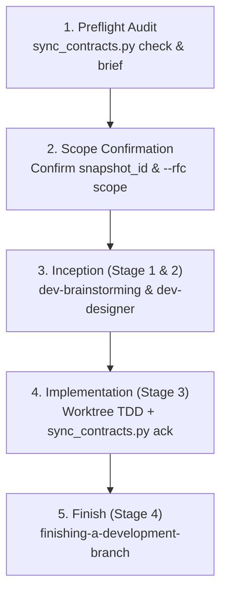

# Sync Shared Contracts

## Overview

The `sync-shared-contracts` skill automates Day-2 continuous synchronization for multi-repository ecosystems initialized with `d3nexus:setup-shared-contracts`.

While `setup-shared-contracts` handles Day-0 topology initialization, `sync-shared-contracts` provides a zero-dependency standard-library Python engine (`sync_contracts.py`) to continuously audit contract deltas, evaluate target codebase readiness, generate structured Contract Requirements Briefs, and orchestrate target repository feature work through `d3nexus:dev-lifecycle`.

## When to Use

- When auditing contract drift between a central Hub control plane and Satellite repositories (worker nodes, web apps, or mobile clients).
- When generating an actionable Contract Requirements Brief (`brief`) with a composite `snapshot_id` to feed into `d3nexus:dev-lifecycle`.
- When running Stage 3 (`dev-implementation`) inside nested git worktrees (`.worktrees/<epic_dir>`) where relative symlinks must resolve cleanly against the primary checkout root.
- When acknowledging contract updates (`ack`) with snapshot-bound guards, selective RFC scope tracking, and semantic baseline persistence in `.agents/contract_sync.json`.

## 3-Layer Hybrid Delta Engine

The CLI engine evaluates synchronization state across three complementary layers:

1. **Layer 1: Git History, SHA-256 Watermark, and Normalized Baseline Diff**:
   - Computes individual SHA-256 hashes for the three canonical files (`api_contract.md`, `architecture_and_flow.md`, `gaps_and_rfcs.md`) and a composite `snapshot_id`.
   - Persists a normalized `baseline_snapshot` in `.agents/contract_sync.json` (including dotted `payload_fields` type mappings such as `metrics.execution_time_ms: integer` and `rfcs` metadata) to enable semantic diffing even without Git history or with uncommitted edits.
2. **Layer 2: Dual-Format Structured Markdown Parser**:
   - Parses both `setup-shared-contracts` Markdown tables and live narrative contracts (HTML comment metadata `Version: X.Y.Z`, `### Title (METHOD /path)` headings, and bullet pairs `* **Method**: ...` / `* **Path**: ...`).
   - Normalizes RFC and Gap statuses from `gaps_and_rfcs.md` into `ACTIONABLE_PENDING` (`OPEN`, `PROPOSED`, `DRAFT`, `IN_REVIEW`), `ACKNOWLEDGED_ACTIVE` (`ACCEPTED`, `APPROVED`, `IMPLEMENTED`), and `INACTIVE` (`SUPERSEDED`, `REJECTED`).
   - Rejects unparseable contracts or files with zero recognizable endpoints with exit code `1` (`UNSUPPORTED_CONTRACT_FORMAT`).
3. **Layer 3: Target Codebase Heuristic Scanner**:
   - Recursively walks target source code (skipping `.git`, `.worktrees`, `shared-contracts`, `.devtool`, `.agents`, and build artifacts).
   - Matches parameterized endpoints (e.g., `/api/v1/lyrics-sync/tasks/{id}/progress` -> static route fragments `/api/v1/lyrics-sync/tasks` and `/progress`), authentication headers, and `snake_case` / `camelCase` DTO field keys (`lease_duration_ms` / `leaseDurationMs`) as `FOUND_IN_CODE` or `MISSING_IN_CODE`.

## Worktree-Aware Topology Resolution

In Satellite repositories, `shared-contracts` is a relative symbolic link pointing to a Hub domain (e.g., `../Hub/shared-contracts/<domain>`).

When Stage 3 (`dev-implementation`) tasks execute inside an isolated worktree at `.worktrees/<epic_dir>`, directory nesting shifts by two levels. `sync_contracts.py` automatically detects worktrees via `.git` metadata and resolves the relative symlink target against the primary repository root without modifying the tracked symlink. Codebase scanning and `.agents/contract_sync.json` writes remain strictly local to the worktree.

Symlink traversal is bounded to a maximum of 10 hops (`MAX_SYMLINK_HOPS = 10`) to prevent infinite recursion on circular links.

## 5-Step Orchestrated Bridge into dev-lifecycle

When bridging contract changes into target codebase implementation, follow this 5-step lifecycle workflow:



### Step 1: Preflight Audit & Brief Generation
Run `sync_contracts.py check` and `sync_contracts.py brief --domain <domain>`.
- If `shared-contracts` is missing or dangling, run `d3nexus:setup-shared-contracts`.
- If status is `IN_SYNC` and no `MISSING_IN_CODE` items remain, report synchronization is complete and stop.

### Step 2: Scope Confirmation
Present the generated **Contract Requirements Brief** to the developer:
- Record the target `snapshot_id`.
- Confirm the implementation scope: either a selected subset of RFCs (`--rfc <ID> ...`) or all active RFCs (`--all-rfcs`).

### Step 3: Inception (Stage 1 & Stage 2)
Enter `d3nexus:dev-lifecycle` using the brief as grounding context:
- **Stage 1 (`dev-brainstorming`)**: Draft the bilingual spec without re-opening settled wire contracts.
- **Stage 2 (`dev-designer`)**:
  - **Hub Mode**: Enforce `task_01` as the contract update task. At the end of `task_01`, run `sync_contracts.py brief` to record the refreshed `snapshot_id`. The final Hub task binds `ack --snapshot <refreshed_id>` to that refreshed snapshot.
  - **Satellite Mode**: Enforce `task_01` as consumer DTO/client update. The tracked symlink `shared-contracts` remains strictly read-only (never added to `Allowed files`).
  - **Both Modes**: The final task includes `.agents/contract_sync.json` in `Allowed files`, executes `sync_contracts.py ack --snapshot <id> [--rfc <ID> ... | --all-rfcs]`, and verifies completion with `sync_contracts.py check --strict` (global) or `sync_contracts.py check --strict --rfc <ID>` (scoped).

### Step 4: Implementation (Stage 3)
Execute tasks inside an isolated worktree (`.worktrees/<epic_dir>`) through `d3nexus:dev-implementation`:
- Run TDD verification for each task.
- The final task executes `sync_contracts.py ack` and confirms strict check passes.
- Run Gate 4 (`quality_check` + traceability checks + audit) and present Review Choice.

### Step 5: Branch Finishing (Stage 4)
Invoke `d3nexus:finishing-a-development-branch` to merge the branch and archive epic artifacts.

## CLI Engine Reference

```bash
# Audit contract drift (exits 0 on IN_SYNC or informational, exits 1 on drift with --strict)
python3 sync_contracts.py check [--repo-root <path>] [--domain <name>] [--json] [--strict] [--rfc <ID> ...]

# Generate Contract Requirements Brief
python3 sync_contracts.py brief [--repo-root <path>] [--domain <name>] [--output <path>]

# Acknowledge watermark state and update baseline snapshot atomically
python3 sync_contracts.py ack [--repo-root <path>] [--domain <name>] [--snapshot <id>] [--rfc <ID> ...] [--all-rfcs]
```

## Watermark Schema (.agents/contract_sync.json)

```json
{
  "schema_version": 1,
  "mode": "satellite",
  "domains": {
    "lyrics-sync": {
      "snapshot_id": "sha256:9f86d081884c7d659a2feaa0c55ad015a3bf4f1b2b0b822cd15d6c15b0f00a08",
      "hub_commit_sha": "a1b2c3d4e5f6a1b2c3d4e5f6a1b2c3d4e5f6a1b2",
      "contract_version": "1.1.0",
      "last_synced_at": "2026-10-30T18:30:00Z",
      "file_hashes": {
        "api_contract.md": "sha256:...",
        "architecture_and_flow.md": "sha256:...",
        "gaps_and_rfcs.md": "sha256:..."
      },
      "acknowledged_rfcs": ["RFC-001"],
      "pending_rfcs": [],
      "acknowledged_endpoints": [
        "POST /api/v1/lyrics-sync/tasks/claim",
        "GET /api/v1/lyrics-sync/status"
      ],
      "baseline_snapshot": {
        "endpoints": ["POST /api/v1/lyrics-sync/tasks/claim"],
        "headers": ["Authorization", "X-Worker-Token"],
        "payload_keys": ["task_id", "lease_duration_ms"],
        "payload_fields": {
          "task_id": "string",
          "lease_duration_ms": "integer"
        },
        "pipeline_steps": ["Lease Acquisition", "Input Validation"],
        "rfcs": {
          "RFC-001": {
            "status": "ACKNOWLEDGED_ACTIVE",
            "raw_status": "APPROVED",
            "title": "Initial Baseline"
          }
        }
      }
    }
  }
}
```

